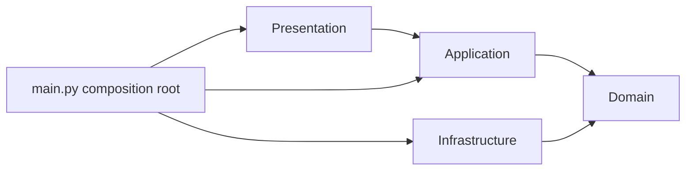
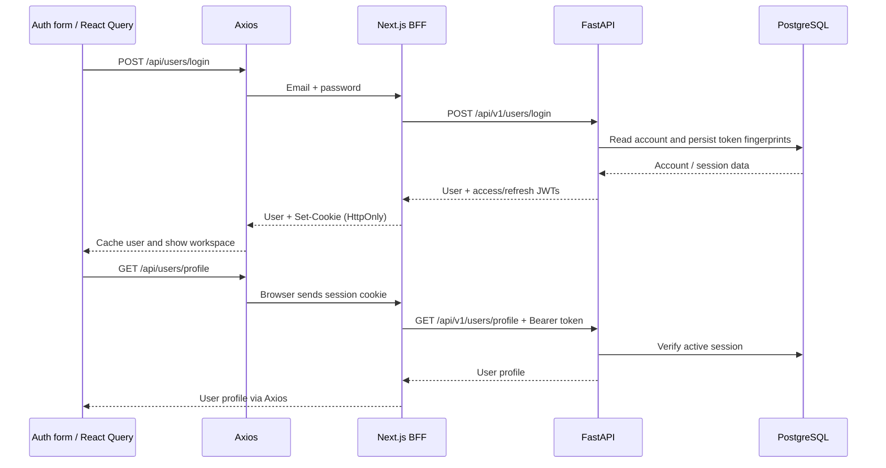

# Clean Workspace Monorepo

FastAPI Clean Architecture backend and Next.js frontend in one repository.

```text
apps/
  api/                 FastAPI app, tests, migrations, Python dependencies and Dockerfile
    app/
      domain/          Framework-free entities and ports
      application/     Business use cases
      infrastructure/  SQLAlchemy, JWT, bcrypt and settings
      presentation/    HTTP schemas and routers
  web/                 Next.js, Tailwind CSS, shadcn/ui, Motion, Axios and React Query
    src/
      app/             Pages and /api Backend for Frontend
      components/      UI and Query providers
      lib/             API clients and shared frontend types
scripts/               Cross-app integration checks
docs/screenshots/      UI verification images
docker-compose.yml     PostgreSQL + API + web
Makefile               Commands for both apps
```

Each app owns its dependencies and Docker build context. Python uses `apps/api/pyproject.toml`;
Next.js uses `apps/web/package.json` and its lockfile. No shared package or build orchestrator is
needed yet. The root `.venv` is ignored local tooling; JS dependencies stay inside `apps/web`.

## Project structure and responsibilities

This is a **polyglot monorepo**: the backend and frontend share a repository but install
dependencies, run tests, and build independently. The root `Makefile` and Docker Compose
coordinate both applications. Clean Architecture defines the layers **inside FastAPI**;
`apps/api` and `apps/web` are separate applications, not the Domain and Presentation layers
of a single application.

```text
.
├── apps/
│   ├── api/
│   │   ├── app/
│   │   │   ├── domain/
│   │   │   │   ├── entities.py       Business data represented as dataclasses
│   │   │   │   ├── ports.py          Repository, password, and token contracts
│   │   │   │   └── errors.py         Errors independent of HTTP
│   │   │   ├── application/
│   │   │   │   ├── users.py          Register, login, authenticate, refresh, logout
│   │   │   │   └── data.py           Resource validation and data retrieval use cases
│   │   │   ├── infrastructure/
│   │   │   │   ├── config.py         Environment settings and validation
│   │   │   │   ├── database.py       SQLAlchemy engine and session factory
│   │   │   │   ├── models.py         ORM models and table definitions
│   │   │   │   ├── repositories.py   Database access and ORM-to-domain mapping
│   │   │   │   └── security.py       Bcrypt and JWT implementations
│   │   │   ├── presentation/
│   │   │   │   ├── schemas.py        Pydantic request/response validation
│   │   │   │   ├── dependencies.py   Request-scoped sessions and authenticated users
│   │   │   │   └── routes.py         HTTP endpoints under /api/v1
│   │   │   └── main.py              Dependency wiring and FastAPI app factory
│   │   ├── migrations/              Alembic environment and versioned schema changes
│   │   ├── tests/                   Unit, HTTP, repository, security, migration tests
│   │   ├── pyproject.toml           Python dependencies and test/lint settings
│   │   ├── alembic.ini              Migration script configuration
│   │   ├── .env.example             Environment template safe to commit
│   │   └── Dockerfile               Backend image build
│   └── web/
│       ├── src/
│       │   ├── app/
│       │   │   ├── layout.tsx        Metadata, local fonts, and providers
│       │   │   ├── page.tsx          Entry point for the client-rendered workspace
│       │   │   ├── globals.css       Tailwind and design tokens
│       │   │   ├── error.tsx         Rendering error UI
│       │   │   ├── not-found.tsx     404 page
│       │   │   └── api/[...path]/route.ts  BFF forwarding and session handling
│       │   ├── components/
│       │   │   ├── providers.tsx     React Query and Motion configuration
│       │   │   ├── auth-form.tsx     Registration and sign-in form
│       │   │   ├── workspace.tsx     Account UI, navigation, overview, profile
│       │   │   ├── workspace-client.tsx  Client-only dynamic workspace boundary
│       │   │   ├── records.tsx       Sessions, permissions, and pagination
│       │   │   └── ui/              Editable shadcn/ui primitives
│       │   ├── hooks/
│       │   │   ├── use-session.ts    Profile query and safe identity replacement
│       │   │   ├── use-auth.ts       Sign-in, logout, and renewal mutations
│       │   │   ├── use-health.ts     Service health query
│       │   │   └── use-records.ts    Typed records and pagination queries
│       │   └── lib/
│       │       ├── api.ts           Browser Axios client and refresh interceptor
│       │       ├── api.test.ts      Client refresh and error-handling tests
│       │       ├── backend.ts       Server-only FastAPI adapter and cookies
│       │       ├── query-keys.ts    Centralized React Query cache keys
│       │       ├── types.ts         TypeScript response types
│       │       └── utils.ts         CSS class utilities
│       ├── public/                 Served static assets, such as mark.svg
│       ├── package.json            Dependencies and npm scripts
│       ├── package-lock.json       Locked dependency versions for npm ci
│       ├── components.json         shadcn component configuration
│       ├── next.config.ts          Next.js standalone build configuration
│       ├── .env.example            Server-side web environment template
│       └── Dockerfile              Next.js production build and runtime
├── scripts/check_frontend.py       Cross-app integration check in Docker
├── docs/screenshots/               UI verification images
├── docker-compose.yml              Network, containers, and PostgreSQL volume
├── Makefile                        Shared developer commands
├── .gitignore                      Excludes secrets, dependencies, generated files
└── LICENSE                         Upstream license
```

Files such as `.env`, `.env.local`, `local.db`, `.venv/`, `node_modules/`, `.next/`, caches,
and `*.egg-info/` contain local data or generated output and should not be committed.
`docs/screenshots` contains documentation images; assets served by the website belong in
`apps/web/public`.

### Backend: Clean Architecture layers

| Layer | Responsibility | Keep out of this layer |
|---|---|---|
| `domain` | Entities, ports, and business errors usable without a server | FastAPI, Pydantic, SQLAlchemy, and table details |
| `application` | Use case workflows and rules, with constructor-injected dependencies | SQL queries, `Depends`, HTTP status codes, and cookies |
| `infrastructure` | Port implementations using database and security libraries | HTTP response decisions |
| `presentation` | Receive and validate requests, invoke use cases, define response schemas | Business workflows or SQL queries inside routers |
| `main.py` | Composition root: select concrete implementations and wire the app | Duplicate business workflows in bootstrap code |

The arrows below show **import/dependency direction**, not request execution order:



For example, `UserService` depends on `UserRepository`, `PasswordHasher`, and `TokenProvider`
from `domain/ports.py`. It does not need to know that the repository uses PostgreSQL or that
password hashing uses bcrypt. `main.py` supplies `SQLUserRepository`, `BcryptPasswordHasher`,
and `JWTTokenProvider`. Unit tests can substitute fake or mock ports without starting an HTTP
server or database.

`presentation/dependencies.py` opens one SQLAlchemy session per request and closes it afterward.
Use cases call `repository.commit()` when a write succeeds. If a request raises an exception,
the dependency rolls back uncommitted work. Reads do not require a commit. This version has no
separate Unit of Work abstraction.

### Frontend: browser and server boundaries

| Component | Execution environment | Responsibility |
|---|---|---|
| `components` + React Query | Browser | UI, loading/error states, mutations, and data caching |
| `lib/api.ts` + Axios | Browser | Call Next.js `/api`, normalize errors, and refresh protected requests |
| `app/api/[...path]/route.ts` | Next.js server | Check the route allowlist, origin, and JSON input; forward requests to FastAPI |
| `lib/backend.ts` | Next.js server only | Read/write HttpOnly cookies and call FastAPI `/api/v1` |
| `lib/types.ts` | TypeScript compile time | Describe expected response shapes; does not validate data at runtime |

Next.js acts as a **Backend for Frontend (BFF)**: it adapts the interface and manages browser
sessions. It does not access the database directly or duplicate FastAPI business rules.
Frontend types are currently handwritten and must be updated when the FastAPI response contract changes.

The workspace UI uses explicit **client-side rendering (CSR)** through `workspace-client.tsx`
with `next/dynamic` and `ssr: false`. The initial HTML contains a loading shell; the browser loads
account data through custom hooks in `src/hooks/`. The Next.js layout, metadata and BFF continue to
run on the server, so the app still requires a Next.js server rather than a static-only host.

Hooks own reusable query/mutation behavior; components retain local presentation state in
`useState`. React Query remains the single cache for API data. Zustand is not installed because
there is currently no shared client-only state that needs a separate global store. It can be added
later for cross-page UI preferences or drafts, without replacing React Query's API cache.

React Query uses `['session']` for the current user, `['health']` for service status, and
`['records', userId, resource, page]` for paginated data. Queries are considered fresh for
30 seconds by default. Signing out cancels pending profile/record reads, removes record queries, and sets the session to `null`.
Pagination placeholders are reused only within the same account and resource.
BFF HTTP responses and server-side fetches use no-store behavior: HTTP caching and React Query's
in-memory caching are separate concerns.

### Example flow: sign in and read a profile



When a protected read returns `401`, Axios calls `/api/users/refresh-token` and retries the
original request once. Concurrent requests within one tab share the same refresh promise.
The BFF reads the refresh token from its cookie and sends it to FastAPI. If refresh returns `401`,
the cookies are cleared and the client handles session expiry. Refresh coordination across
multiple tabs is not implemented. A failed password login does not trigger token refresh.

FastAPI stores passwords as bcrypt hashes and JWTs as SHA-256 fingerprints. Browser JavaScript
receives only the user from BFF login/refresh responses; tokens remain in HttpOnly cookies.
BFF write requests must contain JSON and an `Origin` matching `WEB_ORIGIN`. Direct FastAPI calls
through Swagger continue to use Bearer JWTs according to the backend API contract.

### Where to start when adding a feature

The following example describes how to add **profile editing**, which is not implemented yet:

1. Define input/output and business rules, including editable fields and account ownership.
2. Add required methods to `domain/ports.py` and business errors for any new rules.
3. Add a use case in `application/users.py`, using the user ID from authenticated context.
4. Implement the update in `infrastructure/repositories.py`; add an Alembic migration only if the schema changes.
5. Add request/response schemas and a FastAPI route in `presentation`; wire new adapters in `main.py` if needed.
6. Explicitly add the route/method to the BFF allowlist and update `lib/types.ts` to match the response contract.
7. Add the UI form and a React Query mutation; update or invalidate the session and related queries after success.
8. Test the use case, HTTP authorization/validation, and the complete BFF flow before using it.

A shared model package between Python and TypeScript is not needed at this stage. If multiple
frontends make API types difficult to maintain, consider generating a client from OpenAPI.

### Root command reference

| Command | Behavior | Requirements or notes |
|---|---|---|
| `make install` | Create root `.venv`, install the API in editable mode, and run web `npm ci` | Python/Node installed and package registry access |
| `make dev-api` | Run FastAPI with reload from `apps/api` | Reads `apps/api/.env`; migrate the database before use |
| `make dev-web` | Run the Next.js development server | Reads `apps/web/.env.local` when present |
| `make test` | Run API and Axios tests | API tests use isolated SQLite; Docker is not required |
| `make lint` | Run Ruff and ESLint | Does not rewrite files |
| `make typecheck` | Check TypeScript | Frontend only |
| `make build` | Produce a Next.js production build | Does not build the API Docker image |
| `make up` | Start the DB, build both apps, migrate, and start services | Docker running and API `.env` present |
| `make migrate` | Apply Alembic migrations through an API container | Uses Compose PostgreSQL |
| `make check-integration` | Test web → API → PostgreSQL | All services running; deletes only its own temporary test account |
| `make logs` | Follow API/web logs | Stop following with Ctrl+C |
| `make down` | Stop/remove Compose containers and network | Preserves the PostgreSQL volume and its data |

### Configuration and data locations

| Item | Local development | Docker |
|---|---|---|
| API settings | `apps/api/.env` | Compose reads the same file and overrides `DATABASE_URL` with host `db` |
| Web settings | `apps/web/.env.local` or server code defaults | `environment` of the Compose `web` service |
| SQLite | `apps/api/local.db` when running from the API directory with the prepared configuration | Not used |
| PostgreSQL | URL configured in API settings | Docker-managed named volume `postgres_data` |
| JWT secret | API `.env` | API container environment; never sent to the frontend |
| API server URL | `http://127.0.0.1:8000` | Next.js calls `http://api:8000` over the Compose network |

Inside a container, `localhost` refers to that container itself. Use service names such as `api`
and `db` for container-to-container requests. The browser uses the published host ports `3000`
and `8000`. SQLite and PostgreSQL hold separate datasets; changing `DATABASE_URL` does not
migrate accounts automatically. Setup and startup instructions follow below.

## Run with Docker

The existing local environment and data were preserved during restructuring. For a fresh checkout:

```sh
cp apps/api/.env.example apps/api/.env
python3 -c 'import secrets; print(secrets.token_urlsafe(48))'
```

Set `SECRET_KEY` in `apps/api/.env` to the generated value, then from the repository root:

```sh
make up
```

- Frontend: http://localhost:3000
- Swagger: http://localhost:8000/swagger
- PostgreSQL: localhost:5432 (local sample credentials in Compose)

`make up` builds both apps, waits for PostgreSQL, applies migrations, and starts the stack.
`make down` stops containers and preserves the database volume. Routine schema changes use
`make migrate`. Initial migrations target a fresh database, not an existing Go database.

## Local development

Requires Python 3.11+, Node.js 22+, npm and Make:

If the Docker API/web services are running, use `docker compose stop api web` before starting
development servers to free ports `8000` and `3000`; PostgreSQL can remain running. For a fresh
checkout, create `apps/api/.env` and set its secret as described above. The `.env.example` defaults
to PostgreSQL, so start `docker compose up -d db` and apply migrations from `apps/api` before using the API.

```sh
make install
make dev-api
# In a second terminal:
make dev-web
```

The API reads `apps/api/.env` because `make dev-api` runs from that directory. The preserved local
configuration uses `apps/api/local.db` (SQLite). To use PostgreSQL locally, set `DATABASE_URL` in
that environment file, start `docker compose up -d db`, then run:

```sh
cd apps/api
../../.venv/bin/alembic upgrade head
```

For web configuration, copy `apps/web/.env.example` to `apps/web/.env.local`. By default Next.js
calls FastAPI at `http://127.0.0.1:8000`; in Docker it uses `http://api:8000`. `WEB_ORIGIN` must match
the frontend origin. Local Docker uses HTTP and `COOKIE_SECURE=false`; use secure cookies on HTTPS.

## Verify

```sh
make test
make lint
make typecheck
make build
make check-integration  # Requires running Docker stack
```

Backend tests use an isolated migrated SQLite DB. Axios tests cover refresh deduplication, revoked
sessions, failed login, outages and retry limits. The integration script checks Next.js → FastAPI →
PostgreSQL with a temporary account, then deletes only that account. Desktop and 390px UI were checked.

## Responsibilities

Business rules and database ownership remain in FastAPI. Next.js `/api` is an allowlisted BFF that
handles HttpOnly, SameSite session cookies and forwards requests; tokens are not exposed to React
or localStorage. Axios is the HTTP client; React Query manages loading/errors, mutations and caches
keyed by user/resource/page. Login, registration, profile, sessions and permission reads use real data.
Profile editing, generic write endpoints and admin/RBAC management are not implemented.

- [API architecture, routes and Go conversion differences](apps/api/README.md)
- [Frontend architecture and references](apps/web/README.md)
- [Upstream Go template](https://github.com/max38/golang-clean-code-architecture)

The Apache 2.0 source license is retained in `LICENSE` and in the API build context.
Production frontend dependencies last passed `npm audit --omit=dev`; the full audit has five
transitive development-tool findings from `braces` in eslint tooling. A non-breaking audit fix did
not resolve them; no forced framework downgrade was applied.
